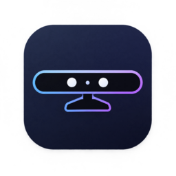

  
  <h1>Kinect Webcam</h1>
  
Xbox 360 Kinect kameranı ve mikrofonunu bilgisayarında kullan.

  

    
    
    
  

  
<strong><a href="https://github.com/yasx01/kinect-webcam/releases/download/windows-v0.1.0/KinectWebcam-Windows-x64.zip">Windows paketini indir (.zip)</a></strong> · <a href="https://github.com/yasx01/kinect-webcam/releases/tag/windows-v0.1.0">Sürüm notları</a> · <a href="docs/LINUX.md">Linux rehberi</a>

---

Kinect Webcam, kamera ve mikrofon kontrollerini tek bir panelde toplar. Görüntüyü uygulama içinde önizleyebilir, mikrofonunu test edebilir ve kamerayı görüşme uygulamalarına aktarabilirsin.

## İndir ve başla

| İşletim sistemi | Nereden başlamalı? |
| --- | --- |
| **Windows 10 (1809+) / 11** · 64 bit | [Windows paketini indir](https://github.com/yasx01/kinect-webcam/releases/download/windows-v0.1.0/KinectWebcam-Windows-x64.zip). Paket `.exe`, kurulum rehberi ve lisansları içerir. |
| **Linux · Fedora KDE** · 64 bit | [Linux kurulum ve derleme rehberini aç](docs/LINUX.md). Paylaşılabilir hazır AppImage henüz sunulmuyor; firmware dosyasını kendin sağlayarak derleyebilirsin. |

### Windows'ta ilk kullanım

1. İndirdiğin ZIP dosyasını **bir kez** çıkar ve içindeki `KinectWebcam-Windows-x64.exe` dosyasını aç.
2. Uygulamadaki **İlk kurulum** bölümünü izle. Kamera için libusbK sürücüsü, tarayıcıya görüntü aktarımı için OBS Virtual Camera gerekir.
3. Kamerayı başlat; görüşme sitesinde **OBS Virtual Camera** ve Kinect mikrofonunu seç.

Mikrofon sistemde görünmüyorsa kendi kullanım hakkına sahip olduğun UACFirmware dosyasını seçmen gerekebilir. Sürücüler otomatik değiştirilmez. [Ayrıntılı Windows rehberi](windows/WINDOWS.md)

> **Windows önizleme sürümü:** Otomatik testler ve `.exe` başlangıç kontrolü geçti. Gerçek Kinect ile fiziksel Windows 10 bilgisayarda ve görüşme uygulamalarında henüz test edilmedi.

## Neler yapabilirsin?

- **Görüntüyü gör:** Canlı önizleme aç, **Test Al** ile bir kareyi sabitle.
- **Mikrofonu kontrol et:** Sessize al, sesi aç veya kısa bir kayıtla dene.
- **Görüşmeye katıl:** Görüntüyü sanal kamera üzerinden tarayıcıya veya OBS'ye aktar.
- **Kurulumu gözden geçir:** İşlemleri incele ve sistem değişikliklerini kullanıcı onayıyla yap.

Mikrofon testi yalnızca sen başlattığında kayıt alır; geçici kayıt normal kapanışta silinir. İşletim sisteminin ve görüşme sitesinin kamera/mikrofon izinleri geçerlidir.

## Geliştiriciler için

- [Linux kurulumu, derleme ve test](docs/LINUX.md)
- [Windows kurulumu ve derleme](windows/WINDOWS.md)
- [Linux v15 sürüm notları](SURUM_v15.md) · [Windows sürüm notları](SURUM_WINDOWS_v01.md)
- [Windows derleme ve test çıktısı](https://github.com/yasx01/kinect-webcam/actions/runs/41283398900)

Linux v15 için 112 otomatik test, Windows için 17 kaynak testi ve paket başlangıç denetimi çalıştırıldı. Bu kontroller gerçek donanım testinin yerini tutmaz.

## Lisans ve üçüncü taraflar

Açık kaynak bileşenlerin bildirimleri kaynak klasörlerinde ve Windows ZIP paketinde yer alır. Microsoft firmware'i, SDK'sı ve sürücüleri bu depoda veya Windows paketinde bulunmaz. Projenin kendi kodu için henüz ayrı bir lisans seçilmemiştir.
